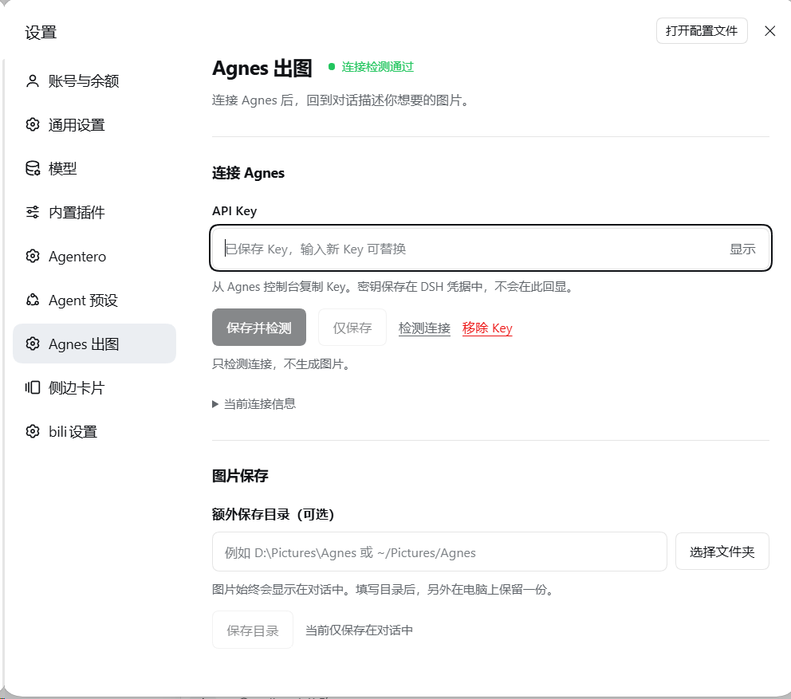

# dsh-agnes-craft

**让用户在 DSH 对话里，用上 Agnes 当前免费的图片生成能力。**

做这个插件的初衷，是把免费出图的入口接到 DeepSeek Harness（DSH）对话里。填好自己的 Agnes API Key 后，直接说想画什么，生成的图片就显示在会话中。也支持参考图编辑、多图合成和可选的本地保存。

> 非官方社区插件，与 DeepSeek、Agnes AI 无隶属关系或官方背书。当前版本 **0.4.4**，作为公开测试版发布。插件本身免费开源；Agnes 图片 API 当前的免费条件见下文。

## 免费出图：适用条件

根据 [Agnes 国际站官方定价页](https://www.agnes-ai.com/zh-Hans/docs/pricing)（核对日期：2026-11-13），以下模型当前对默认用户（`default`）提供免费体验：

| 图片模型 | 当前免费范围 |
| --- | --- |
| `agnes-image-2.5-flash`（插件默认） | 1K、2K、3K、4K 输出图片，以及输入参考图片 |
| `agnes-image-2.1-flash` | 同上 |
| `agnes-image-2.0-flash` | 同上 |

这些计费项的当前体验价均为 **`$0`**，输入参考图片包含第 4 张及之后的图片。使用自己的、符合活动条件的国际站 Key，即可通过本插件调用。插件默认 API 地址为 `https://apihub.agnes-ai.com/v1`。

这是平台当前的试用优惠，**不代表永久或无限免费**。Agent Plan 用户不参加该体验价和限时免费活动，按套餐规则计费；优惠期限、账户适用情况及实际费用以 Agnes 平台公告和账户账单为准。国内站、自定义代理或其他模型的计费需另行核对。DSH 对话模型是否收费，则取决于你自己的模型配置。

## 能做什么

- 在对话里调用 `agnes_image`，生成结果以图片内容块显示。
- 传入最多 8 张参考图，进行图片编辑或多图合成。
- 在设置页保存、替换、移除 API Key，单独检测连接，或保存后直接检测。
- 选择额外保存目录，保留一份本地图片；关闭额外保存后，图片仍显示在对话里。
- 分别显示已保存、待检测、检测通过和失败状态；目录草稿支持保存与撤销。

## 界面预览



设置页实拍：连接检测通过，API Key 不回显，可按需选择额外保存目录。

## 安装

要求：DSH `>=0.2.2-rc.1 <0.3.0`，宿主 Node.js `>=22.14.0`。插件需要 DSH 的工具、附件和凭据服务。

1. 从 [Releases](https://github.com/SG-ovo/dsh-agnes-craft/releases) 下载 `dsh-agnes-craft-0.4.4.tgz`。
2. 在 DSH 对话中提供本地包路径，请 DSH 使用插件管理工具安装。例如：`请安装本地插件包 D:\Downloads\dsh-agnes-craft-0.4.4.tgz`。
3. 重启或重新加载 DSH 客户端，进入 **设置 → Agnes 出图**。
4. 按上面的免费条件确认账户适用情况，粘贴自己的 API Key，点击 **保存并检测**。也可以仅保存，之后单独检测。

检测连接会请求模型列表，不会发起图片生成。检测失败时，已保存的 Key 会保留，可处理问题后重试。

如果客户端设置入口没有加载，可访问 `<DSH 地址>/agnes-craft` 使用简化的 Key 配置页。

从源码安装时，先在插件目录执行 `npm install`，再让 DSH 安装该目录。目录安装需要可解析的本地依赖；优先使用 Releases 中的 `.tgz` 包。具体开发流程见 [CONTRIBUTING.md](CONTRIBUTING.md)。

## 使用

回到 DSH 对话，描述你想生成的图片，并写明分辨率和画幅：

```text
画一张雨夜书店的插画，暖色灯光，2K，画幅 16:9。
```

编辑图片时提供参考图，例如：

```text
把这张图改成水彩风格，保留人物和构图，2K，画幅 3:4。
```

插件接受的参考图参数是公开 HTTP(S) 地址或 `data:image/...;base64`。本地路径和 DSH 附件引用不能直接作为 `images` 参数，需要调用方转换为受支持的格式。

### 工具参数

| 参数 | 说明 |
| --- | --- |
| `prompt` | 必填，画面描述 |
| `size` | 必须明确提供：`1K`、`2K`、`3K` 或 `4K` |
| `ratio` | 必须明确提供：`1:1`、`3:4`、`4:3`、`16:9`、`9:16`、`2:3`、`3:2` 或 `21:9` |
| `model` | 可选，覆盖默认模型 `agnes-image-2.5-flash` |
| `images` | 可选，最多 8 张参考图；提供后使用图生图请求 |

缺少分辨率或画幅时，工具会要求先向用户确认。配置中的 `size` 和 `aspectRatio` 仅用于建议，不会绕过调用参数检查。

## 设置与数据

API Key 通过 DSH Credentials 保存，默认引用名为 `AGNES_API_KEY`。插件配置中不保存 Key 明文。

在 **图片保存** 中选择或填写目录，再点击 **保存目录**。选择文件夹只填入草稿，保存后才应用；可撤销未保存修改，或点击 **关闭额外保存**。

额外保存目录写入 `$DSH_HOME/agnes-craft/settings.json`，未设置 `DSH_HOME` 时使用 `~/.dsh/agnes-craft/settings.json`。设置即时生效。图片先存入 DSH 附件服务；额外写盘失败时只追加提示，不影响已存入附件的图片。

| 配置项 | 默认值 | 说明 |
| --- | --- | --- |
| `baseURL` | `https://apihub.agnes-ai.com/v1` | API 根地址；国内站为 `https://api.agnes-ai.cn/v1` |
| `credentialRef` | `AGNES_API_KEY` | DSH 凭据引用名 |
| `imageModel` | `agnes-image-2.5-flash` | 默认模型 |
| `timeoutMs` | `180000` | 单次请求超时，毫秒 |
| `maxImageBytes` | `33554432` | 单张图片大小上限，字节 |
| `outputDir` | 空 | 初始额外保存目录；设置页保存值优先 |

仅对已知 Agnes 官方地址执行 401/403 站点回退。自定义 API 地址不会自动切换到官方地址。图片生成遇临时服务错误时不自动重复提交。

## 验证范围

- 42 条基础与回归测试，包含本地 HTTP 的请求、响应和下载链路检查。
- 9 项 Chrome 浏览器操作检查，使用 React 18 模拟 DSH 的插槽和 API，覆盖设置页主要操作及窄屏、深色主题。
- 这些检查不调用真实 Agnes 生成接口；当前版本尚未完成真实 DSH 宿主的完整验收。

运行基础测试不需要安装依赖：

```sh
npm test
npm run check
```

浏览器检查需要本机 Chrome，并单独安装测试依赖：

```sh
cd test/ui
npm ci
cd ../..
npm run test:ui
```

默认截图输出到 `test/ui/artifacts`，不会随源码提交。变更记录见 [CHANGELOG.md](CHANGELOG.md)。

## 参考来源与许可

项目由 AI 辅助开发，早期实现参考过以下项目：

- [@ayui124/dsh-openai-image-tools](https://github.com/AYui124/dsh-openai-image-tools)：附件数据结构及工具注册写法。
- [dsh-agnes-create](https://github.com/zxygithub/dsh-agnes-create)：早期接口约定及路由处理写法。
- [dshmarket](https://github.com/dsh-market/dsh-market)：客户端设置入口及同源路由使用方式。

上述来源已核实的参考版本均使用 MIT 许可。版本、原版权声明和许可全文保留在 [THIRD-PARTY-NOTICES.md](THIRD-PARTY-NOTICES.md)。Agnes API 参数参考其[公开文档](https://www.agnes-ai.com/zh-Hans/docs/overview)。项目不宣称全部实现均为独立原创。

本项目采用 [MIT License](LICENSE)。分发源码或安装包时，请同时保留 `LICENSE` 和 `THIRD-PARTY-NOTICES.md`。
